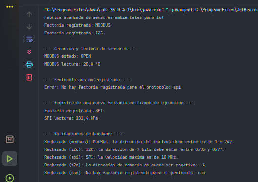
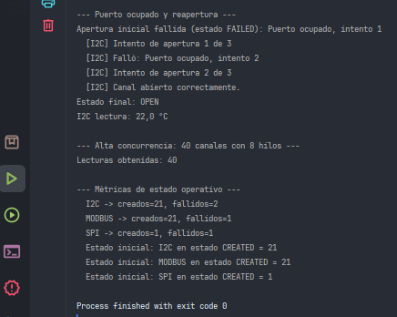

# Ejercicio 09 - Fábrica Avanzada de Sensores Ambientales para IoT

## Descripción

Una plataforma industrial de telemetría recopila datos de hardware mediante protocolos de comunicación de bajo nivel, como ModBus, I2C y SPI. Este ejercicio construye un sistema desacoplado que valida los parámetros de hardware y las direcciones de memoria de cada canal, crea el canal de lectura adecuado, gestiona su estado y registra métricas operativas, todo de forma segura ante alta concurrencia.

## Objetivos

- Diseñar un reto avanzado que combine el Factory Method con principios SOLID, gestión de estado de conexiones y manejo eficiente de recursos bajo alta concurrencia.
- Inicializar y configurar canales de lectura de sensores validando parámetros de hardware y direcciones de memoria.
- Proveer un mecanismo centralizado que cree el canal adecuado y registre métricas de estado operativo inicial para cada protocolo.
- Manejar excepciones de forma robusta ante fallos en la inicialización de los puertos de hardware.
- Permitir registrar nuevas factorías de protocolos en tiempo de ejecución sin modificar el código base.
- Crear cuarenta canales desde ocho hilos y verificar las métricas resultantes.

## Implementación del patrón Factory Method

Se utiliza la variante **Factory Method con Template Method y registro dinámico de factorías**.

1. **Producto:** `SensorChannel` extiende `AutoCloseable` y define `open()`, `read()`, `reopen()` y `close()`; `BaseSensorChannel` gestiona el estado (`CREATED`, `OPEN`, `CLOSED` y `FAILED`) con métodos `synchronized` y simula fallos de hardware.
2. **Productos concretos:** `ModbusChannel`, `I2cChannel` y `SpiChannel`, con una lectura simulada propia.
3. **Creador abstracto:** `SensorFactory` declara el método de fábrica `createChannel()` y el método plantilla `create()`, que valida reglas comunes (puerto, velocidad positiva y dirección de memoria no negativa) y reglas del protocolo, crea el canal y registra las métricas. Todo fallo se informa como `SensorInitializationException`.
4. **Creadores concretos:** `ModbusSensorFactory` (esclavo de 1 a 247, registro de 0 a 65535 y 9600, 19200 o 115200 baudios), `I2cSensorFactory` (dirección de 0x03 a 0x77, registro de 0 a 255 y 100 kHz o 400 kHz) y `SpiSensorFactory` (chip select de 0 a 3, registro de 0 a 255 y hasta 10 MHz).
5. **Punto centralizado:** `SensorFactoryRegistry` mantiene un `ConcurrentHashMap` de factorías y permite registrar nuevos protocolos mientras la aplicación corre.
6. **Métricas:** `SensorMetrics` cuenta creaciones, fallos y estados iniciales por protocolo con `LongAdder`.

**SOLID aplicado:** responsabilidad única (validar, crear, medir y gestionar el canal están en clases distintas), abierto/cerrado (nuevas factorías por registro) e inversión de dependencias (el cliente usa `SensorChannel` y el registro).

## Propósito de la clase

- `SensorChannel` y `BaseSensorChannel`: contrato y base del ciclo de vida de un canal de lectura.
- `ModbusChannel`, `I2cChannel` y `SpiChannel`: canales concretos con lecturas simuladas.
- `SensorConfig`: configuración inmutable con puerto, dirección del dispositivo, dirección de memoria y velocidad.
- `SensorFactory`: método de fábrica y plantilla de creación validada.
- `ModbusSensorFactory`, `I2cSensorFactory` y `SpiSensorFactory`: reglas de hardware y creación de cada protocolo.
- `SensorFactoryRegistry`: registro concurrente de factorías, con alta y baja en tiempo de ejecución.
- `SensorMetrics`: métricas de estado operativo seguras para concurrencia.
- `SensorInitializationException`: error de configuración, creación o apertura.
- `Main`: crea canales, registra SPI en ejecución, rechaza configuraciones inválidas, simula un puerto ocupado y lanza cuarenta creaciones con ocho hilos.

## Concepto clave

**La creación queda desacoplada del uso.** El cliente pide un canal por protocolo y la arquitectura decide cómo validarlo y construirlo; como el registro es un mapa concurrente, se pueden sumar protocolos nuevos sin recompilar ni modificar lo existente.

## Resultado

## Conclusión

La prueba muestra la lectura de sensores ModBus, SPI e I2C, el alta de SPI en ejecución, el rechazo de direcciones, registros y velocidades fuera de rango, y la apertura exitosa de un puerto ocupado tras reintentos. Las cuarenta lecturas concurrentes terminan correctamente y las métricas reflejan los éxitos y los fallos por protocolo.
